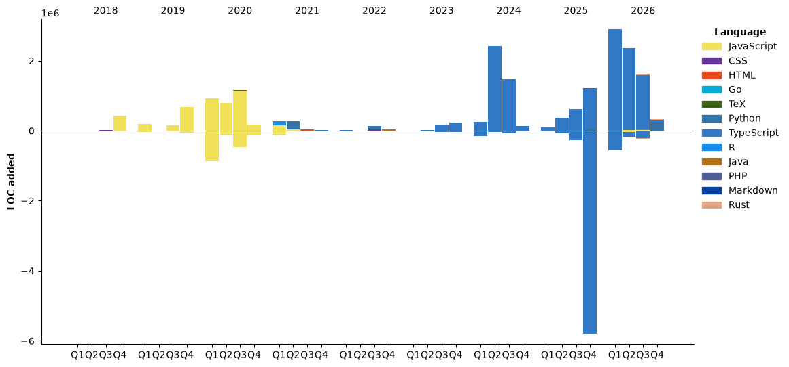

<h1 align="center">Hi 👋, I'm Hector Garzon</h1>
<h3 align="center">A passionate frontend developer from Colombia</h3>

<p align="left">  </p>

- 🌱 I’m currently learning **Data Structures and Algorithms, Docker and MySQL**

- 💬 Ask me about **React Js, JavaScript**

<p align="center">  </p>

<p align="center">
<a href="https://twitter.com/devhectorga" target="blank"></a>
<a href="https://linkedin.com/in/devhectorga" target="blank"></a>
</p>
<!--START_SECTION:waka-->


**🐱 My GitHub Data** 

> 📦 1.4 MB Used in GitHub's Storage 
 > 
> 🏆 1,236 Contributions in the Year 2026
 > 
> 🚫 Not Opted to Hire
 > 
> 📜 64 Public Repositories 
 > 
> 🔑 15 Private Repositories 
 > 
**I'm an Early 🐤** 

```text
🌞 Morning                4738 commits        ████░░░░░░░░░░░░░░░░░░░░░   17.02 % 
🌆 Daytime                9692 commits        █████████░░░░░░░░░░░░░░░░   34.81 % 
🌃 Evening                11843 commits       ███████████░░░░░░░░░░░░░░   42.53 % 
🌙 Night                  1571 commits        █░░░░░░░░░░░░░░░░░░░░░░░░   05.64 % 
```
📅 **I'm Most Productive on Thursday** 

```text
Monday                   3738 commits        ███░░░░░░░░░░░░░░░░░░░░░░   13.42 % 
Tuesday                  3761 commits        ███░░░░░░░░░░░░░░░░░░░░░░   13.51 % 
Wednesday                3994 commits        ████░░░░░░░░░░░░░░░░░░░░░   14.34 % 
Thursday                 6084 commits        █████░░░░░░░░░░░░░░░░░░░░   21.85 % 
Friday                   3684 commits        ███░░░░░░░░░░░░░░░░░░░░░░   13.23 % 
Saturday                 2511 commits        ██░░░░░░░░░░░░░░░░░░░░░░░   09.02 % 
Sunday                   4072 commits        ████░░░░░░░░░░░░░░░░░░░░░   14.62 % 
```


📊 **This Week I Spent My Time On** 

```text
🕑︎ Time Zone: America/Bogota

💬 Programming Languages: 
No Activity Tracked This Week

🔥 Editors: 
No Activity Tracked This Week

🐱‍💻 Projects: 
No Activity Tracked This Week

💻 Operating System: 
No Activity Tracked This Week
```

🤖 **AI Coding This Week** 

```text
No AI Coding Activity Tracked This Week
```

**I Mostly Code in JavaScript** 

```text
TypeScript               14 repos            ██████░░░░░░░░░░░░░░░░░░░   22.58 % 
Java                     2 repos             █░░░░░░░░░░░░░░░░░░░░░░░░   03.23 % 
Rust                     1 repo              ░░░░░░░░░░░░░░░░░░░░░░░░░   01.61 % 
PHP                      1 repo              ░░░░░░░░░░░░░░░░░░░░░░░░░   01.61 % 
Markdown                 1 repo              ░░░░░░░░░░░░░░░░░░░░░░░░░   01.61 % 
```


**Timeline**




 Last Updated on 01/11/2026 11:30:01 UTC
<!--END_SECTION:waka-->
